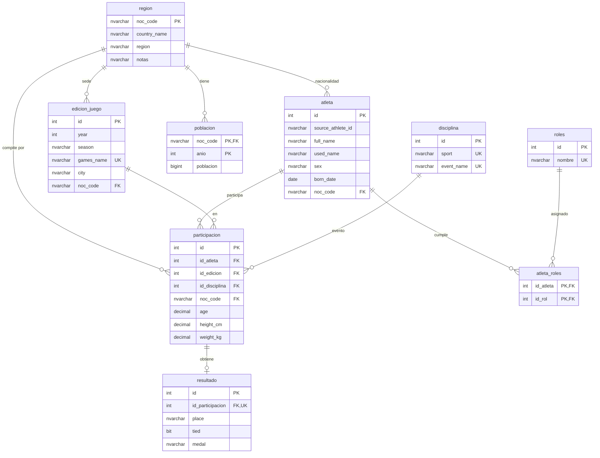
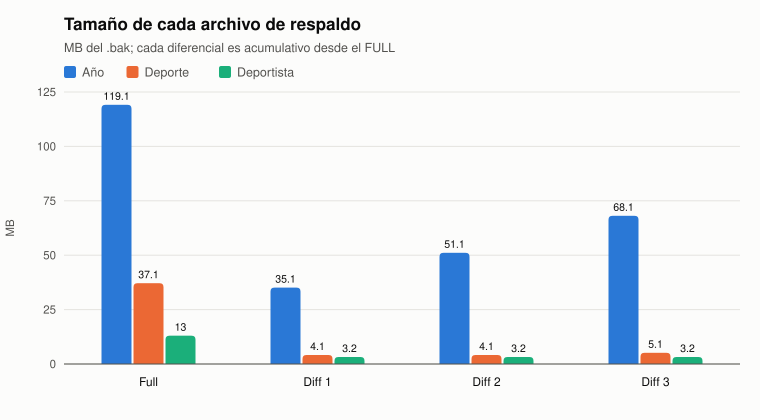
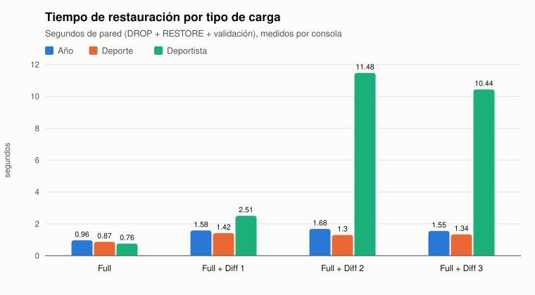
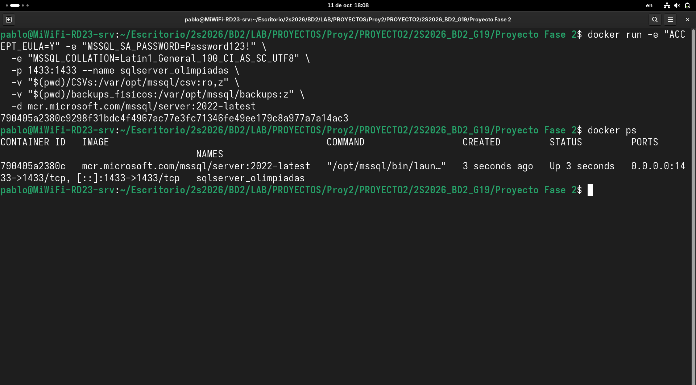
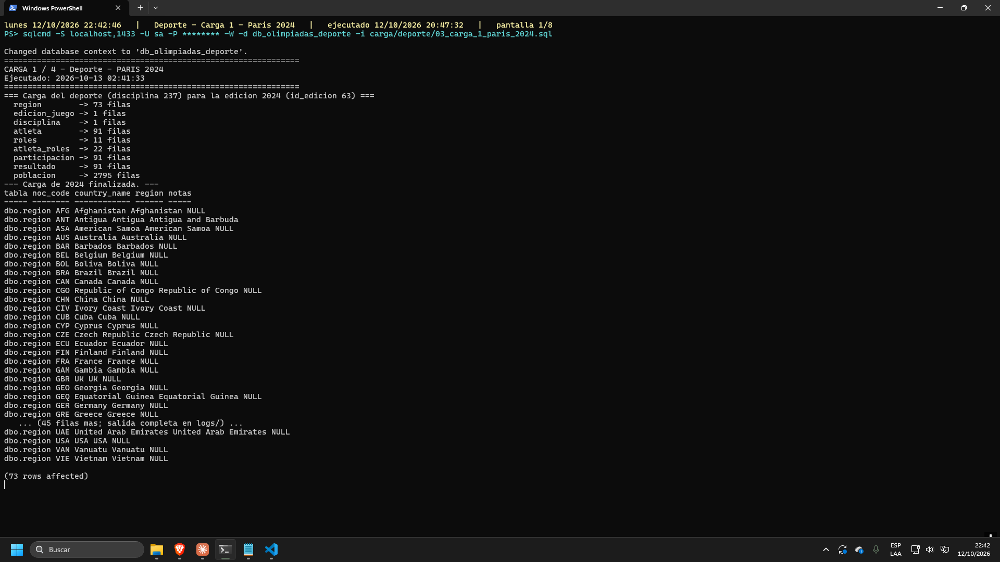
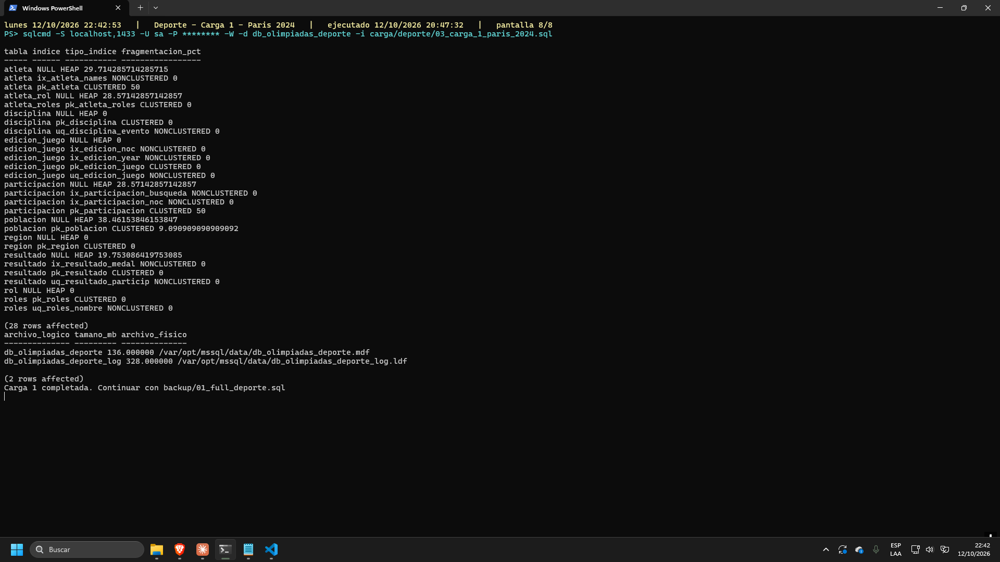
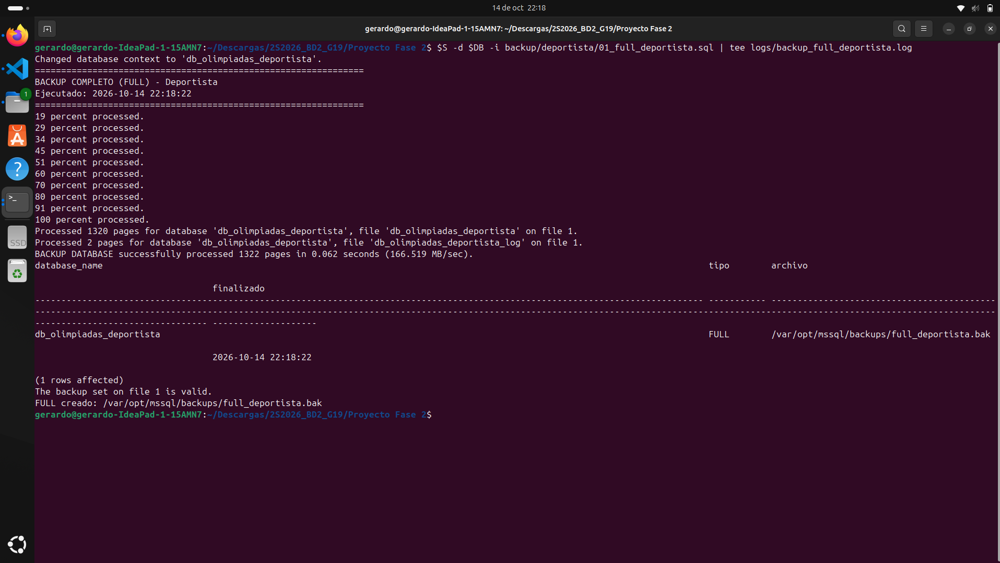
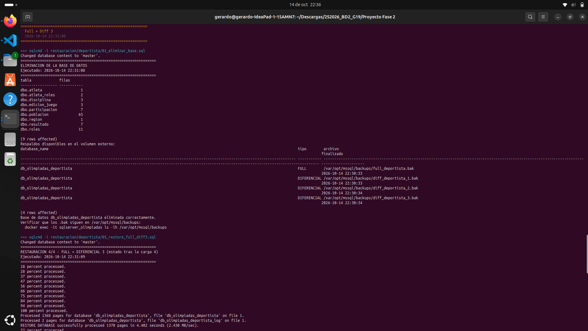
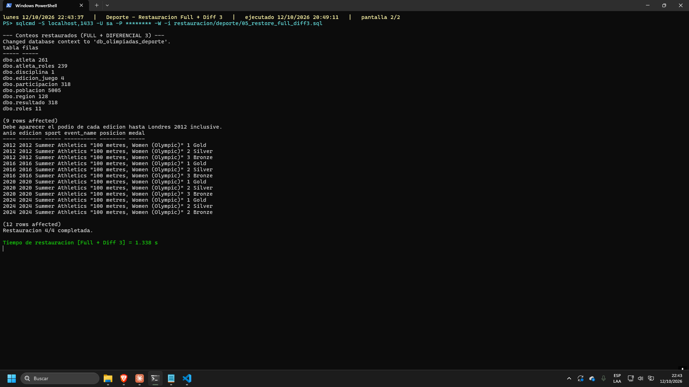
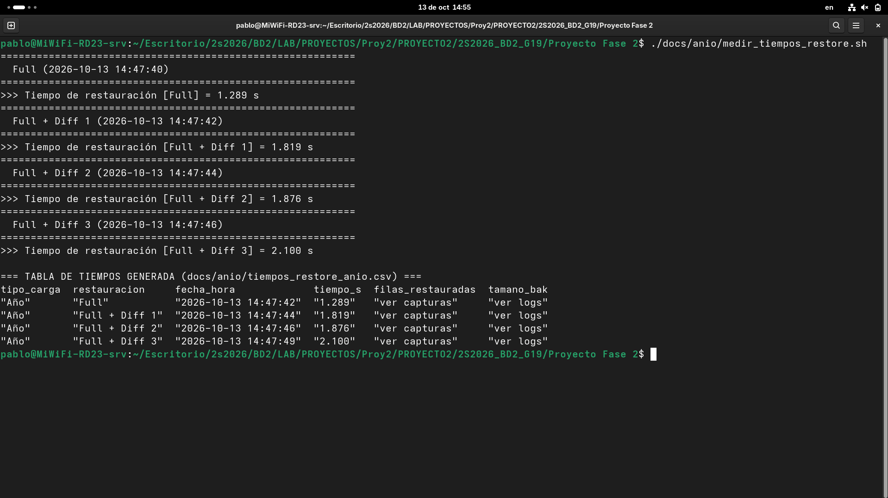

# Documentación Técnica — Proyecto 2: Respaldo y Restauración

**Sistemas de Bases de Datos 2 · Grupo 19** — Pablo (carga por año), José (carga
por deporte), Gerardo (carga por deportista).

Este documento describe la metodología, el modelo de datos, el entorno, el plan
de respaldo y los resultados de las tres cargas, y cierra con el análisis
comparativo y la recomendación final. Todos los números provienen de los logs
de `logs/`, de las capturas de `capturas/` y de la tabla de tiempos de
`Checklist.md`; el procedimiento paso a
paso de cada carga está en `README_anio.md`, `README_deporte.md` y
`README_deportista.md`.

---

## Contenido

1. [Metodología](#1-metodología)
2. [Modelo entidad-relación](#2-modelo-entidad-relación)
3. [Especificaciones técnicas del servidor](#3-especificaciones-técnicas-del-servidor)
4. [Plan de respaldo](#4-plan-de-respaldo)
5. [Volumen de datos por tipo de carga](#5-volumen-de-datos-por-tipo-de-carga)
6. [Resultados de respaldo y restauración](#6-resultados-de-respaldo-y-restauración)
7. [Análisis comparativo](#7-análisis-comparativo)
8. [Conclusiones y recomendación](#8-conclusiones-y-recomendación)
9. [Limitaciones conocidas](#9-limitaciones-conocidas)
10. [Evidencia de ejecución](#10-evidencia-de-ejecución)
11. [Organización del repositorio](#11-organización-del-repositorio)

---

## 1. Metodología

### 1.1 Objetivo

Medir el comportamiento de una estrategia de **respaldo físico completo +
diferencial** en SQL Server bajo tres patrones de carga distintos sobre el mismo
modelo relacional del Proyecto 1, y determinar qué estrategia conviene según el
volumen de datos.

### 1.2 Fases del trabajo

| Fase | Quién | Resultado |
|---|---|---|
| 1. Preparación y diseño | Los tres juntos | Motor, herramienta de respaldo, convención de nombres y carpetas (`CONVENCIONES.md`) |
| 2. Carga, respaldo y restauración | Cada integrante con su tipo de carga | 4 cargas, 1 full + 3 diferenciales, 4 restauraciones medidas |
| 3. Evidencia | Cada integrante | Logs de consola y capturas con fecha y hora |
| 4. Consolidación | Los tres | Tabla global de tiempos y este documento |

### 1.3 Los tres tipos de carga

Cada integrante trabaja en **su propia base de datos** para que el
`DROP DATABASE`, el staging y los `.bak` de uno no afecten a otro. El modelo
(`ddl/`) es compartido y recibe el nombre de la base como variable de `sqlcmd`.

| Tipo de carga | Integrante | Base de datos | Criterio de selección | Ediciones, en orden de carga |
|---|---|---|---|---|
| Por **año** | Pablo | `db_olimpiadas_anio` | Edición olímpica completa | París 2024 → Tokio 2020 → Río 2016 → Londres 2012 |
| Por **deporte** | José | `db_olimpiadas_deporte` | `id_disciplina = 237` (Athletics, *100 metres, Women*) + edición | París 2024 → Tokio 2020 → Río 2016 → Londres 2012 |
| Por **deportista** | Gerardo | `db_olimpiadas_deportista` | `athlete_id = 105512` (Usain Bolt) + edición | Atenas 2004 → Pekín 2008 → Londres 2012 → Río 2016 |

### 1.4 Flujo de carga: staging y filtro

Los CSV del Proyecto 1 no coinciden en nombres de columna con el modelo final y
`BULK INSERT` no admite filtros, así que la carga se hace en dos pasos:

1. **Staging (`stg.*`).** Nueve tablas de texto, sin claves ni índices, que
   reproducen exactamente los CSV. `BULK INSERT` carga cada CSV completo.
2. **Modelo final (`dbo.*`).** Un procedimiento almacenado por tipo de carga
   (`sp_cargar_anio`, `sp_cargar_deporte`, `sp_cargar_deportista`) recibe la
   edición y ejecuta `INSERT dbo.<tabla> ... SELECT ... FROM stg.<tabla> WHERE <criterio>`.
   Ese `WHERE` es lo que materializa el tipo de carga.

Al terminar cada carga, el procedimiento **purga del staging** lo que ya no se
va a usar. Sin la purga, las ~323 mil participaciones y ~153 mil atletas del
staging quedarían dentro del primer FULL y los diferenciales posteriores no
medirían el costo real de cada carga.

### 1.5 Ciclo por tipo de carga

```
crear base (ddl) → staging → carga 1 → FULL
                           → carga 2 → DIFERENCIAL 1
                           → carga 3 → DIFERENCIAL 2
                           → carga 4 → DIFERENCIAL 3
para cada estado (FULL, FULL+D1, FULL+D2, FULL+D3):
    DROP DATABASE → RESTORE → validar conteos → medir tiempo
```

La cuarta carga existe para llegar a los **tres diferenciales** que pide el
enunciado.

### 1.6 Medición

- **Tiempo de restauración:** tiempo de pared medido desde la consola
  (PowerShell `Get-Date`/`Stopwatch` o `date` en bash) alrededor del script de
  restauración. Incluye el `RESTORE` y las consultas de validación.
- **Tamaño:** tamaño del archivo `.bak` en el volumen del host.
- **Filas restauradas:** suma de filas de las nueve tablas `dbo.*` después de
  cada restauración, comparada contra los conteos tomados antes del `DROP`.
- **Fragmentación:** `sys.dm_db_index_physical_stats` después de cada carga.

Todo se ejecuta **por consola** (`sqlcmd`, PowerShell o bash); ninguna operación
de respaldo o restauración se hizo desde una interfaz gráfica.

---

## 2. Modelo entidad-relación

El modelo relacional es **copia fiel del DDL de la Fase 1**
(`ddl/00_referencia_DDL_Fase1.sql`) y se crea con `ddl/03_modelo_relacional.sql`.
No se modificó para este proyecto.



*`atleta` tiene además columnas descriptivas (otros nombres, títulos,
afiliaciones, lugar de nacimiento y defunción, coordenadas) que se omiten del
diagrama.*

| Tabla | Contenido | Claves e índices |
|---|---|---|
| `region` | Comités olímpicos nacionales (NOC) | PK `noc_code` |
| `edicion_juego` | Ediciones de los Juegos | PK `id`, UNIQUE `games_name`, índices por `noc_code` y `year` |
| `disciplina` | Deporte + evento | PK `id`, UNIQUE (`sport`, `event_name`) |
| `atleta` | Datos biográficos | PK `id`, índice (`full_name`, `used_name`) |
| `participacion` | Un atleta en un evento de una edición | PK `id`, 4 FK, índices de búsqueda y por `noc_code` |
| `resultado` | Posición y medalla de una participación (1 a 1) | PK `id`, UNIQUE `id_participacion`, índice por `medal` |
| `poblacion` | Serie histórica de población por país | PK (`noc_code`, `anio`) |
| `roles`, `atleta_roles` | Roles de un atleta (competidor, entrenador, etc.) | PK compuesta en `atleta_roles` |

El esquema `stg.*` (`ddl/02_esquema_staging.sql`) existe solo como área de
carga: nueve tablas `NVARCHAR(MAX)` sin claves, con la collation
`Latin1_General_100_CI_AS_SC_UTF8`.

---

## 3. Especificaciones técnicas del servidor

### 3.1 Software común a los tres integrantes

| Componente | Versión / valor |
|---|---|
| Motor | Microsoft SQL Server 2022 Developer Edition (64-bit), RTM-CU27, 16.0.4295.3 |
| Imagen | `mcr.microsoft.com/mssql/server:2022-latest` (Ubuntu 22.04.5 LTS) |
| Contenedor | `sqlserver_olimpiadas`, puerto 1433 |
| Collation del servidor | `Latin1_General_100_CI_AS_SC_UTF8` (variable `MSSQL_COLLATION`) |
| Volumen de datos de origen | `CSVs/` del repositorio → `/var/opt/mssql/csv` (solo lectura) |
| Volumen de respaldos | carpeta del host → `/var/opt/mssql/backups` (persiste al eliminar la base) |
| Cliente | `sqlcmd` (go-sqlcmd en Windows, `mssql-tools18` dentro del contenedor en Linux) |
| Tipo de respaldo | Físico nativo: `BACKUP DATABASE` (full) y `WITH DIFFERENTIAL` |

Comando de arranque del contenedor (la ruta del host cambia según el equipo):

```bash
docker run -e "ACCEPT_EULA=Y" -e "MSSQL_SA_PASSWORD=Password123!" \
  -e "MSSQL_COLLATION=Latin1_General_100_CI_AS_SC_UTF8" \
  -p 1433:1433 --name sqlserver_olimpiadas \
  -v /ruta/host/CSVs:/var/opt/mssql/csv:ro \
  -v /ruta/host/backups:/var/opt/mssql/backups \
  -d mcr.microsoft.com/mssql/server:2022-latest
```

### 3.2 Equipo de cada integrante

Cada tipo de carga se midió en el equipo de su integrante, por eso los tiempos
absolutos de una carga no son estrictamente comparables con los de otra (ver
sección 7.4).

| Tipo de carga | Sistema operativo del host | Cliente |
|---|---|---|
| Año (Pablo) | Linux con SELinux (volúmenes montados con `:z`) | `sqlcmd` dentro del contenedor (`docker exec`), script `medir_tiempos_restore.sh` |
| Deporte (José) | Windows 11 Pro 10.0.26200, Docker Desktop (WSL 2) | go-sqlcmd v1.10.0 en el host, PowerShell 5.1 |
| Deportista (Gerardo) | Ubuntu (laptop Lenovo IdeaPad 1 15AMN7) | `sqlcmd` en el host, PowerShell (`pwsh`) |

---

## 4. Plan de respaldo

### 4.1 Estrategia: Full + Diferencial

SQL Server ofrece respaldos completos, diferenciales y de log de transacciones;
no tiene un respaldo "incremental" como tal. El enunciado permite elegir entre
incremental y diferencial, y se eligió el **diferencial**:

- **FULL** (`BACKUP DATABASE ... WITH INIT`): copia todas las páginas en uso de
  la base. Es la base de la cadena.
- **DIFERENCIAL** (`BACKUP DATABASE ... WITH DIFFERENTIAL, INIT`): copia las
  páginas modificadas **desde el último FULL**. Es acumulativo: el diferencial 3
  contiene también los cambios de los diferenciales 1 y 2.

| Momento | Respaldo | Archivo |
|---|---|---|
| Después de la carga 1 | FULL | `full_<tipo>.bak` |
| Después de la carga 2 | DIFERENCIAL 1 | `diff_<tipo>_1.bak` |
| Después de la carga 3 | DIFERENCIAL 2 | `diff_<tipo>_2.bak` |
| Después de la carga 4 | DIFERENCIAL 3 | `diff_<tipo>_3.bak` |

`<tipo>` es `anio`, `deporte` o `deportista`. Los nombres son disjuntos, así que
los tres pueden compartir el mismo volumen sin pisarse.

### 4.2 Opciones de respaldo y por qué

| Opción | Motivo |
|---|---|
| `WITH INIT` | Sobrescribe el archivo si existe; permite repetir el ciclo sin acumular conjuntos de respaldo en el mismo `.bak`. |
| `STATS = 10` | Imprime el avance cada 10 %; esa salida es la evidencia de ejecución por consola que queda en `logs/`. |
| Sin `COMPRESSION` | Los tamaños de full y diferencial se comparan sin el efecto de la compresión. |
| `RESTORE VERIFYONLY` | Comprueba que cada `.bak` sea legible justo después de crearlo. |

### 4.3 Procedimiento de restauración

Antes de cada restauración se **elimina la base completa**
(`ALTER DATABASE ... SET SINGLE_USER WITH ROLLBACK IMMEDIATE; DROP DATABASE`),
como pide el enunciado. Los `.bak` sobreviven porque están en un volumen del
host, fuera del contenedor.

| Estado a recuperar | Secuencia |
|---|---|
| Tras la carga 1 | `RESTORE ... FROM full WITH RECOVERY, REPLACE` |
| Tras la carga N (N = 2, 3, 4) | `RESTORE ... FROM full WITH NORECOVERY, REPLACE` y luego `RESTORE ... FROM diff_(N-1) WITH RECOVERY` |

El FULL se restaura con `NORECOVERY` cuando le sigue un diferencial: con
`RECOVERY` la base queda en línea y ya no acepta más respaldos. Como el
diferencial es acumulativo, para cualquier estado bastan **dos archivos**
(full + el diferencial correspondiente), sin aplicar los anteriores.

### 4.4 Validación de integridad

Después de cada restauración, el script:

1. Lista desde `msdb` qué respaldos existen y cuándo se tomaron.
2. Cuenta las filas de las nueve tablas `dbo.*` y las compara con las tomadas
   antes del `DROP`.
3. Muestra una consulta de negocio que confirma el contenido (el podio del
   evento en deporte, las participaciones del atleta en deportista).

---

## 5. Volumen de datos por tipo de carga

Filas **agregadas** por cada carga a las tablas principales (salida de los
procedimientos de carga, en `logs/`):

| Tipo de carga | Carga | Edición | Participaciones | Atletas | Países (NOC) | Población |
|---|---|---|---|---|---|---|
| Año | 1 | París 2024 | 14 735 | 11 092 | 207 | 7 800 |
| Año | 2 | Tokio 2020 | 13 951 | 8 070 | 2 | 65 |
| Año | 3 | Río 2016 | 13 742 | 7 417 | 2 | 65 |
| Año | 4 | Londres 2012 | 12 975 | 6 545 | 0 | 0 |
| Deporte | 1 | París 2024 | 91 | 91 | 73 | 2 795 |
| Deporte | 2 | Tokio 2020 | 68 | 59 | 20 | 520 |
| Deporte | 3 | Río 2016 | 80 | 56 | 21 | 910 |
| Deporte | 4 | Londres 2012 | 79 | 55 | 14 | 780 |
| Deportista | 1 | Atenas 2004 | 1 | 1 | 1 | 65 |
| Deportista | 2 | Pekín 2008 | 3 | 0 | 0 | 0 |
| Deportista | 3 | Londres 2012 | 3 | 0 | 0 | 0 |
| Deportista | 4 | Río 2016 | 3 | 0 | 0 | 0 |

Total de filas en las nueve tablas `dbo.*` al terminar cada carga:

| Tipo de carga | Tras carga 1 | Tras carga 2 | Tras carga 3 | Tras carga 4 |
|---|---|---|---|---|
| Año | 52 495 | 97 411 | 140 504 | 180 009 |
| Deporte | 3 176 | 3 992 | 5 207 | 6 285 |
| Deportista | 84 | 93 | 100 | 107 |

Las tres cargas cubren **tres órdenes de magnitud** de volumen (cientos, miles y
cientos de miles de filas), que es lo que permite comparar las estrategias.

---

## 6. Resultados de respaldo y restauración

### 6.1 Tamaño de los respaldos

| Tipo de carga | FULL | DIFERENCIAL 1 | DIFERENCIAL 2 | DIFERENCIAL 3 |
|---|---|---|---|---|
| Año | 119.10 MB (15 122 páginas) | 35.10 MB (4 298) | 51.10 MB (6 354) | 68.10 MB (8 578) |
| Deporte | 37.13 MB (4 610) | 4.13 MB (386) | 4.13 MB (402) | 5.13 MB (418) |
| Deportista | 13.00 MB (1 370) | 3.20 MB (258) | 3.20 MB (258) | 3.20 MB (258) |



### 6.2 Tiempos de restauración

Valores de la tabla de tiempos de `Checklist.md` (sección 5). "Filas
restauradas" es la suma de las nueve tablas `dbo.*` después de restaurar,
tomada de los logs de restauración.

| Tipo de carga | Restauración | Tiempo (s) | Filas restauradas | Archivos aplicados |
|---|---|---|---|---|
| Año | Full | 0.965 | 52 495 | 119.10 MB |
| Año | Full + Diff 1 | 1.582 | 97 411 | 119.10 + 35.10 MB |
| Año | Full + Diff 2 | 1.681 | 140 504 | 119.10 + 51.10 MB |
| Año | Full + Diff 3 | 1.555 | 180 009 | 119.10 + 68.10 MB |
| Deporte | Full | 0.870 | 3 176 | 37.13 MB |
| Deporte | Full + Diff 1 | 1.415 | 3 992 | 37.13 + 4.13 MB |
| Deporte | Full + Diff 2 | 1.302 | 5 207 | 37.13 + 4.13 MB |
| Deporte | Full + Diff 3 | 1.338 | 6 285 | 37.13 + 5.13 MB |
| Deportista | Full | 0.759 | 84 | 13.00 MB |
| Deportista | Full + Diff 1 | 2.506 | 93 | 13.00 + 3.20 MB |
| Deportista | Full + Diff 2 | 11.481 | 100 | 13.00 + 3.20 MB |
| Deportista | Full + Diff 3 | 10.441 | 107 | 13.00 + 3.20 MB |



En todos los casos los conteos después de restaurar coinciden con los tomados
antes de eliminar la base: **ninguna restauración perdió ni duplicó filas**.

### 6.3 Tiempo del RESTORE dentro del motor

SQL Server informa cuánto tardó cada `RESTORE` por sí solo. Separa el costo del
motor del costo de la consola, el `DROP` y las consultas de validación:

| Tipo de carga | Full (solo) | Full + Diff 3: full | Full + Diff 3: diferencial |
|---|---|---|---|
| Año | 0.373 s | 0.372 s | 0.362 s |
| Deporte | 0.189 s | 0.187 s | 0.165 s |
| Deportista | 0.264 s | 4.402 s | 4.278 s |

### 6.4 Tabla de tiempos registrada en `Checklist.md`

Reproducción textual de la sección 5 de `Checklist.md`, donde cada integrante
anotó sus mediciones. Es la fuente de los tiempos de las secciones 6.2 y 7.

| Tipo de carga | Restauración | Tiempo (s) | Filas restauradas | Tamaño del .bak |
|---|---|---|---|---|
| Año | Full | 0.965 | 14735 | 119.10 MB |
| Año | Full + Diff 1 | 1.582 | 13951 | 35.10 MB |
| Año | Full + Diff 2 | 1.681 | 13742 | 51.10 MB |
| Año | Full + Diff 3 | 1.555 | 12975 | 68.10 MB |
| Deporte | Full | 0.870 | 3 176 | 37.13 MB |
| Deporte | Full + Diff 1 | 1.415 | 3 992 | 37.13 MB + 4.13 MB |
| Deporte | Full + Diff 2 | 1.302 | 5 207 | 37.13 MB + 4.13 MB |
| Deporte | Full + Diff 3 | 1.338 | 6 285 | 37.13 MB + 5.13 MB |
| Deportista | Full | 0.759 | 84 | 13.00 MB |
| Deportista | Full + Diff 1 | 2.506 | 93 | 13.00 MB + 3.20 MB |
| Deportista | Full + Diff 2 | 11.481 | 100 | 13.00 MB + 3.20 MB |
| Deportista | Full + Diff 3 | 10.441 | 107 | 13.00 MB + 3.20 MB |

Diferencias de criterio entre las filas, que la sección 6.2 unifica:

- **Filas restauradas de "Año":** el Checklist anota las participaciones de
  cada edición por separado (14 735, 13 951, …). Deporte y Deportista anotan la
  suma de las nueve tablas `dbo.*` después de restaurar. Con ese mismo criterio,
  los logs de Año dan 52 495, 97 411, 140 504 y 180 009 filas.
- **Tamaño del .bak de "Año":** en las filas con diferencial se anota solo el
  diferencial; Deporte y Deportista anotan full + diferencial, que son los dos
  archivos que se aplican.

---

## 7. Análisis comparativo

### 7.1 El FULL crece con el volumen; el diferencial, con el cambio

El FULL de **Año** pesa 9 veces el de **Deportista** (119 MB contra 13 MB)
porque copia todas las páginas en uso. Los diferenciales, en cambio, siguen al
volumen de **lo modificado desde el FULL**:

- En **Año** cada carga agrega ~13–14 mil participaciones y el diferencial crece
  en cada paso (35 → 51 → 68 MB): al ser acumulativo, el diferencial 3 lleva
  las cargas 2, 3 y 4 juntas.
- En **Deporte** y **Deportista** los cambios son pequeños y los diferenciales
  quedan casi constantes (4–5 MB y 3.2 MB). Ahí domina el **tamaño mínimo** de
  un diferencial: los encabezados, el mapa de extensiones modificadas y las
  páginas de sistema que cambian con cualquier escritura.

### 7.2 El diferencial ahorra espacio, no tiempo de restauración

Restaurar el estado tras la carga 4 con el diferencial acumulativo exige **dos
archivos** en cualquier tipo de carga (full + diff 3), nunca la cadena completa.
Por eso el tiempo de **Full + Diff 3** es del mismo orden que el de
**Full + Diff 1**: en Año 1.56 s contra 1.58 s y en Deporte 1.34 s contra
1.42 s.

Lo que sí ahorra el diferencial es espacio. Guardar los cuatro estados con
respaldos completos costaría en Año aproximadamente 119 + 154 + 170 + 187 MB;
con full + diferenciales cuesta 119 + 35 + 51 + 68 = **273 MB**.

### 7.3 Con poco volumen, el tiempo lo dominan costos fijos

En Deporte y Deportista restaurar cientos o miles de filas tarda prácticamente
lo mismo que restaurar 180 mil en Año (0.8–1.6 s de pared). A ese volumen el
tiempo lo dominan costos fijos: crear los archivos de la base, poner la base en
línea, el `DROP` previo y las consultas de validación. Dentro del motor
(sección 6.3) el `RESTORE` de cada archivo toma entre 0.17 y 0.37 s en ambos
casos.

### 7.4 El caso atípico: Deportista con Diff 2 y Diff 3

Los 11.5 s y 10.4 s de **Deportista** no se deben al volumen: son 258 páginas,
las mismas que en Diff 1. La sección 6.3 muestra que el motor tardó 4.4 s en
restaurar un FULL que en otras corridas tomó 0.26 s. Es un efecto del
**almacenamiento del equipo** en ese momento (escritura en el volumen montado
del host), no de la estrategia. Por eso los tiempos absolutos solo se comparan
**dentro** de cada tipo de carga, y entre tipos se comparan las tendencias.

### 7.5 Fragmentación

Después de cada carga, `sys.dm_db_index_physical_stats` muestra fragmentación
alta en las tablas pequeñas (50 % en `pk_atleta` y `pk_participacion` con 91
filas en Deporte). Con tan pocas páginas el porcentaje no es significativo: una
tabla de dos páginas fuera de orden ya marca 50 %. Las tablas de staging (heaps)
quedan fragmentadas por la purga. Ninguna de las dos cosas afecta los respaldos,
porque `BACKUP` copia páginas sin importar su orden lógico.

### 7.6 Resumen

| Aspecto | Año | Deporte | Deportista |
|---|---|---|---|
| Filas finales | 180 009 | 6 285 | 107 |
| FULL | 119.10 MB | 37.13 MB | 13.00 MB |
| DIFERENCIAL 3 | 68.10 MB | 5.13 MB | 3.20 MB |
| Diferencial 3 / FULL | 57 % | 14 % | 25 % |
| Restaurar estado final | 1.555 s | 1.338 s | 10.441 s* |
| Archivos para el estado final | 2 | 2 | 2 |

\* Afectado por el almacenamiento del equipo; ver sección 7.4.

---

## 8. Conclusiones y recomendación

1. **Full + diferencial es la estrategia adecuada para los tres volúmenes.** En
   ningún caso fue necesario aplicar más de dos archivos para recuperar
   cualquier estado, y las cuatro restauraciones de cada tipo devolvieron
   exactamente los conteos previos al `DROP`.

2. **Con volúmenes grandes y cambios frecuentes (carga por año), el diferencial
   crece rápido** y llegó al 57 % del FULL en tres cargas. La recomendación es
   **tomar un FULL nuevo cuando el diferencial supere aproximadamente la mitad
   del FULL**, para que el diferencial vuelva a ser pequeño y la restauración
   siga necesitando solo dos archivos.

3. **Con volúmenes pequeños (por deporte o por deportista), el diferencial es
   casi constante** y su tamaño lo fija el mínimo del motor, no los datos. Se
   puede mantener la misma base FULL mucho más tiempo; hacer FULL frecuentes
   solo ocuparía espacio sin mejorar la recuperación.

4. **El tiempo de restauración no depende del número de diferenciales**, porque
   el diferencial de SQL Server es acumulativo. Lo que crece con el tiempo es el
   tamaño del diferencial, no la cantidad de archivos.

5. **Para volúmenes pequeños, el tiempo de restauración lo dominan costos fijos**
   (crear la base, ponerla en línea, el almacenamiento del equipo), así que la
   elección de estrategia debe basarse en espacio y en simplicidad de la cadena,
   no en segundos.

6. **Si se necesitara recuperar a un punto en el tiempo** (entre dos cargas),
   habría que agregar respaldos del log de transacciones con el modelo de
   recuperación `FULL`. Con full + diferencial solo se recupera a los momentos
   exactos en que se tomó cada respaldo.

---

## 9. Limitaciones conocidas

| Limitación | Efecto | Detalle |
|---|---|---|
| `BULK INSERT` en Linux no admite `CODEPAGE` | Los caracteres multibyte (`•`, `×`, acentos) se guardan como mojibake (`ΓÇó`) | Cosmético: no afecta conteos, claves, tamaños ni tiempos. Por eso los filtros usan identificadores y no nombres. `README_deportista.md`, sección 3. |
| `FIELDQUOTE` sin `FORMAT = 'CSV'` | Un campo entre comillas con coma (`"Racers Track Club, Kingston (JAM)"`) se parte y la fila se corre una columna | Afecta columnas descriptivas de `atleta` (`born_date`, `born_city`). No afecta claves ni conteos. |
| CSV con saltos de línea CRLF | El `\r` queda en la última columna y no se puede convertir a número | Resuelto con `.gitattributes` (LF para `Proyecto Fase 2/CSVs/*.csv`). |
| `region` vacía en `tabla_nocs.csv` (TUV, ROT, UNK) | `country_name` es `NOT NULL` | Se usa el código NOC como nombre de país. |
| Atletas de París 2024 | Las participaciones, países y medallas son correctos, pero varios `athlete_id` apuntan a personas que no corresponden | Viene del emparejamiento de nombres del pipeline de la Fase 1 para 2024. No afecta volúmenes ni tiempos. |
| Carga 1 de Deporte lenta (~6 min) en la versión original | No afecta respaldos ni restauraciones; solo la duración de la carga | La purga del staging usaba `NOT IN` sobre expresiones sin índices. Se reemplazó por tablas temporales (`#atl`, `#keep_*`) y la carga 1 bajó a 6.4 s, con datos idénticos fila por fila. Las capturas y tiempos de Deporte se tomaron con la versión anterior; como los datos y los respaldos son los mismos, siguen siendo válidos. |
| Tiempos medidos en equipos distintos | Los tiempos absolutos entre tipos de carga no son directamente comparables | Sección 7.4. |

---

## 10. Evidencia de ejecución

Selección de capturas de los tres integrantes. Todas muestran la fecha y hora
del sistema; el juego completo está en `capturas/` y en cada README.

### 10.1 Contenedor de SQL Server levantado (Año)



### 10.2 Carga y respaldo

Carga 1 de Deporte (París 2024): filas insertadas por tabla.



Fragmentación de índices y tamaño de la base después de la carga 1 (Deporte).



Respaldo FULL de Deportista con verificación `RESTORE VERIFYONLY`.



### 10.3 Eliminación y restauración

Eliminación de la base y restauración FULL + DIFERENCIAL 3 (Deportista).



Validación después de FULL + DIFERENCIAL 3 (Deporte): conteos iguales a los de
antes del `DROP` y podio de las cuatro ediciones.



### 10.4 Medición de tiempos (Año)

Ejecución de `medir_tiempos_restore.sh` del 13/10/2026 a las 14:47. Los tiempos
de esta captura (1.289 a 2.100 s) son de una corrida distinta a la registrada en
`Checklist.md`, que es la que usa la sección 6.2.



---

## 11. Organización del repositorio

```
Proyecto Fase 2/
├── ddl/                  modelo compartido (recibe -v DbNombre)
├── carga/{anio,deporte,deportista}/         staging, procedimiento y 4 cargas
├── backup/{anio,deporte,deportista}/        full + 3 diferenciales
├── restauracion/{anio,deporte,deportista}/  eliminar base + 4 restauraciones
├── docs/{anio,deporte,deportista}/          medición de tiempos
├── docs/graficos/        gráficos de este documento
├── logs/                 salida de consola de cada paso
├── capturas/             capturas con fecha y hora
├── CSVs/                 datos de origen (Proyecto 1)
├── CONVENCIONES.md       reglas comunes del equipo
├── Checklist.md          seguimiento y tabla de tiempos
├── Manual_Usuario.md     operación de respaldos y restauraciones
├── Documentacion_Tecnica.md   este documento
├── probar_todo.sh       prueba de punta a punta de las tres cargas (Ubuntu: sudo ./probar_todo.sh)
└── README_{anio,deporte,deportista}.md      procedimiento de cada carga
```
