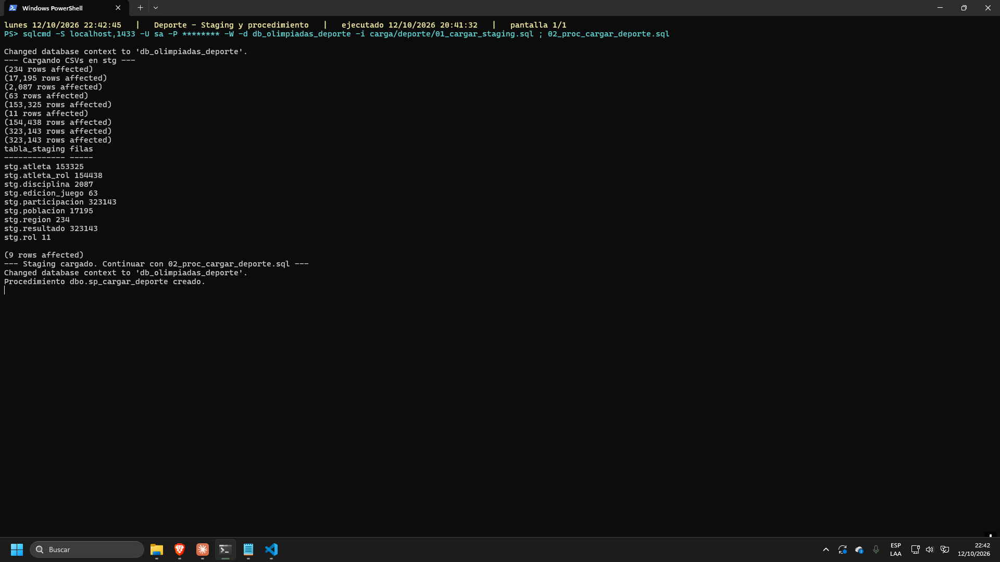
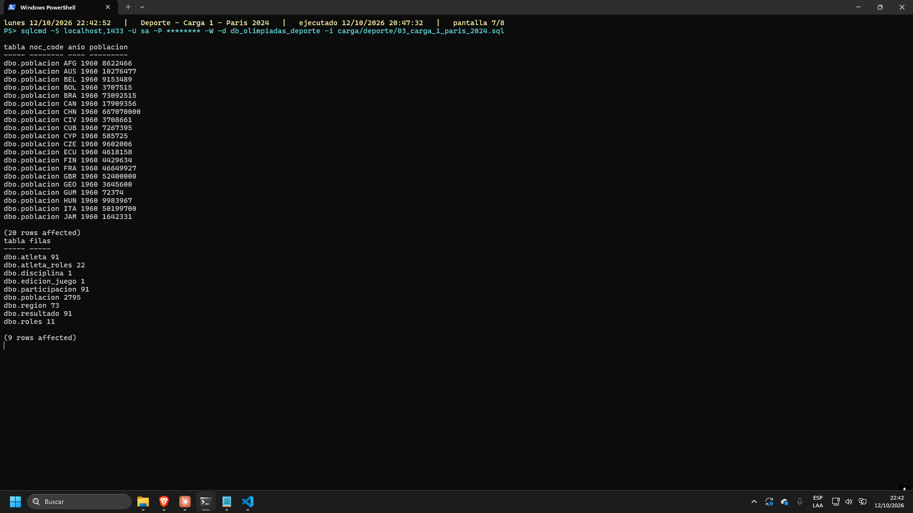
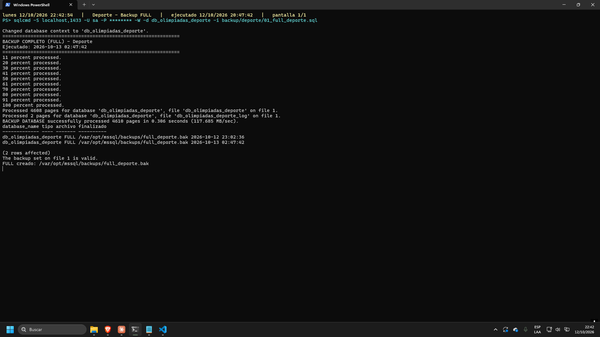
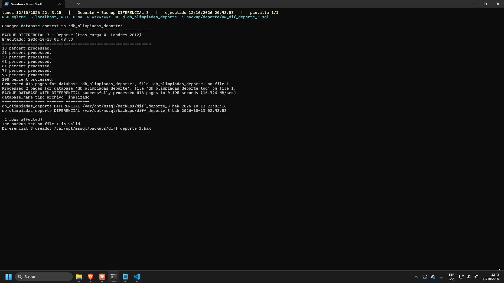
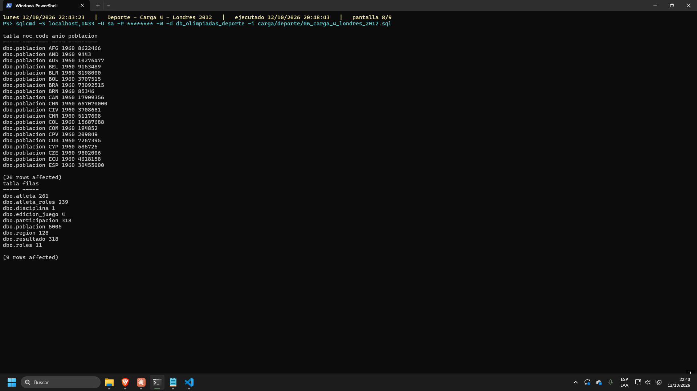
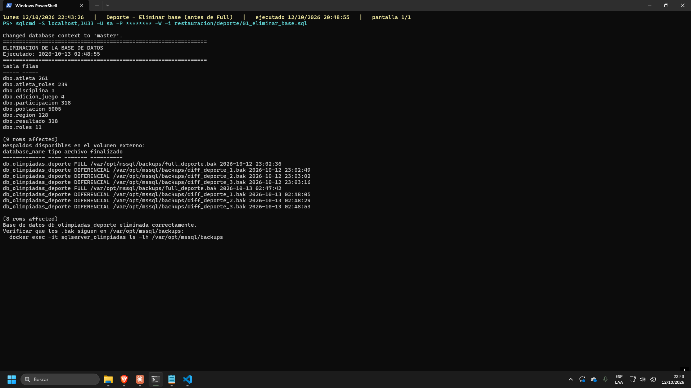
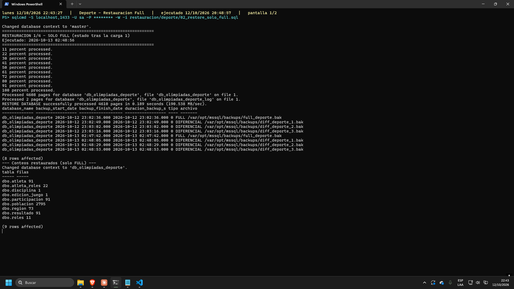
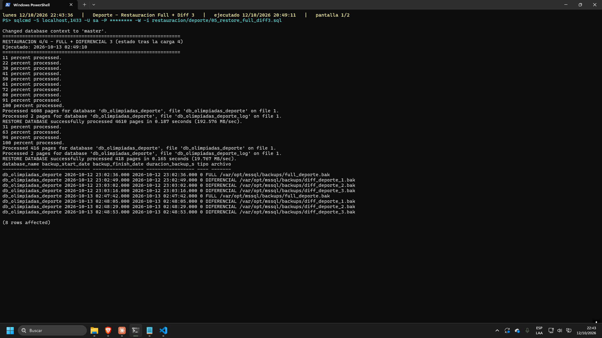
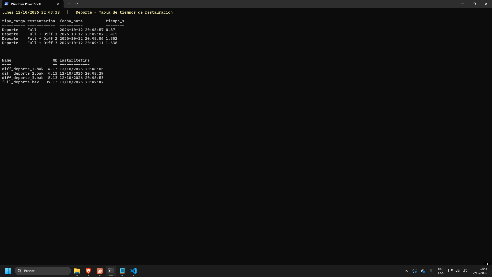

# Fase 2 — Respaldo y Restauración · José (carga por DEPORTE)

Entregable de **José** del grupo 19: la parte del proyecto que
carga los datos **por deporte**, tomando los **100 m planos femeninos**
(`id_disciplina = 237`) como caso de estudio a lo largo de cuatro ediciones.

| Integrante | Tipo de carga | Base de datos | Carpeta |
|---|---|---|---|
| **Pablo** | por **año** | `db_olimpiadas_anio` | `*/anio/` |
| **José** | por **deporte** | `db_olimpiadas_deporte` | `*/deporte/` |
| **Gerardo** | por **deportista** | `db_olimpiadas_deportista` | `*/deportista/` |

Cada quien trabaja en su propia base y su propia carpeta, para que nadie pise el
`DROP DATABASE`, el staging ni los `.bak` del otro. El `ddl/` es **compartido**
y parametrizado. El detalle está en `CONVENCIONES.md`.

Todo se ejecuta **por consola** (`sqlcmd` / PowerShell), nunca con la interfaz
gráfica, y todo queda registrado en `logs/`.

> Los scripts de `*/deporte/` son los de `*/deportista/` con los nombres, las
> ediciones y el filtro cambiados, para que las tres entregas tengan el mismo
> formato. Las únicas diferencias de fondo están listadas en la sección 8.

---

## 1. Por qué existe el esquema `stg`

El modelo final `dbo.*` **no se tocó**: es copia fiel del DDL entregado en la
Fase 1 (`Proyecto Fase 1/cambios_modelo/DDL_Creacion_Objetos.sql`), y en este
proyecto tiene que seguir coincidiendo exactamente con aquel.

El problema real es que los CSV de `CSVs/` **no tienen los mismos nombres de
columna** que el modelo final, y además hay dos columnas `NOT NULL` en `dbo.*`
que **no existen en ningún CSV**:

| Modelo final | CSV de origen | Cómo se resuelve |
|---|---|---|
| `dbo.region.country_name` (NOT NULL) | `tabla_nocs.csv` solo trae `NOC, region, notes` | se deriva de `region` |
| `dbo.edicion_juego.games_name` (NOT NULL) | `tabla_edicion_juego.csv` solo trae `id, year, season, city` | se deriva como `"<anio> <season>"` |
| `dbo.atleta.id` / `source_athlete_id` | `athlete_id` | `SET IDENTITY_INSERT` |
| `dbo.participacion.id_atleta` | `athlete_id` (viene como `64991.0`) | `TRY_CAST(... AS INT)` |
| `dbo.participacion.id_edicion` | `id_edicion_juego` | `TRY_CAST` |
| `dbo.participacion.equipo` | `team` | `TRY_CAST` |
| `dbo.resultado` | trae `id_resultado` que el modelo no usa | se descarta |
| `dbo.atleta_roles.id_atleta` | `athlete_id` | `TRY_CAST` |
| `dbo.roles.nombre` | `nombre_rol` | `TRY_CAST` |

La solución es `stg.*`: nueve tablas que reproducen **exactamente** los CSV
(cabecera incluida, con sus espacios y paréntesis), tipadas como texto y sin
PK/FK/índices. Cada carga hace después
`INSERT dbo.<tabla> (...) SELECT ... FROM stg.<tabla> WHERE <filtro>`, y ese
`WHERE` es lo que materializa el criterio de selección de cada integrante. En
esta carga es `id_disciplina = 237 AND id_edicion_juego = <edición>`.

Ventaja adicional: `BULK INSERT` no admite `WHERE`, así que cargar el CSV
completo a staging y filtrar después evita depender de herramientas de terceros
y deja el criterio de filtrado **visible dentro del propio script**, que es
justo lo que el enunciado pide evidenciar.

---

## 2. Estructura del repositorio

```
/ddl            (COMPARTIDO) 01_crear_base_datos.sql    crea la base, recibe -v DbNombre
                02_esquema_staging.sql     las 9 tablas stg.*
                03_modelo_relacional.sql   dbo.* (copia fiel de la Fase 1)
                00_referencia_DDL_Fase1.sql  copia del DDL original, sin tocar

/carga/deporte  01_cargar_staging.sql         BULK INSERT de los 9 CSV
                02_proc_cargar_deporte.sql    sp_cargar_deporte @anio
                03_carga_1_paris_2024.sql     carga 1 + evidencia
                04_carga_2_tokio_2020.sql     carga 2 + evidencia
                05_carga_3_rio_2016.sql       carga 3 + evidencia
                06_carga_4_londres_2012.sql   carga 4 + evidencia

/backup/deporte        01_full_deporte.sql   full_deporte.bak
                02_dif_deporte_1.sql  diff_deporte_1.bak
                03_dif_deporte_2.sql  diff_deporte_2.bak
                04_dif_deporte_3.sql  diff_deporte_3.bak

/restauracion/deporte  01_eliminar_base.sql            DROP DATABASE
                02_restore_solo_full.sql        solo el FULL
                03_restore_full_diff1.sql       FULL + DIF 1
                04_restore_full_diff2.sql       FULL + DIF 2
                05_restore_full_diff3.sql       FULL + DIF 3

/docs/deporte   medir_tiempos_restore.ps1  cronómetro + tabla de tiempos
/capturas       capturas de pantalla de consola
/logs           salida de consola de cada backup y restore
/CSVs           datos de origen (montados en /var/opt/mssql/csv)
```

---

## 3. Limitación conocida: codificación de caracteres no-ASCII

Es la misma limitación que documenta la sección 3 de `README_deportista.md`
(ahí está el detalle de la causa y de todo lo que se intentó) y la sección 7 de
`CONVENCIONES.md`.

**Síntoma.** Los caracteres multibyte de los CSV se guardan corruptos en la
base. En esta carga se ve en los nombres de las atletas:

| Valor real en el CSV | Cómo queda en la base |
|---|---|
| `Shelly-Ann•Fraser-Pryce` (`•` = U+2022) | `Shelly-AnnΓÇóFraser-Pryce` |

**Causa.** `BULK INSERT` en Linux **no admite la opción `CODEPAGE`** (error
`16202`), así que el motor lee el archivo como **CP437** y no como UTF-8.

**Impacto real: nulo para la evaluación.** El problema es puramente cosmético.
No afecta a:

- los conteos de filas de ninguna tabla,
- las claves primarias y foráneas,
- el tamaño de los `.bak`,
- los tiempos de respaldo y restauración,
- la fragmentación de índices.

Por eso la disciplina se identifica por **id** (237) y no por nombre.

---

## 4. Puesta en marcha

```bash
docker run -e "ACCEPT_EULA=Y" -e "MSSQL_SA_PASSWORD=Password123!" \
  -e "MSSQL_COLLATION=Latin1_General_100_CI_AS_SC_UTF8" \
  -p 1433:1433 --name sqlserver_olimpiadas \
  -v /ruta/host/ProyectoFase2/CSVs:/var/opt/mssql/csv:ro \
  -v /ruta/host/backups:/var/opt/mssql/backups \
  -d mcr.microsoft.com/mssql/server:2022-latest
```

> El directorio de `backups` debe ser escribible por el usuario `mssql`
> (uid 10001) del contenedor: `chmod 777 /ruta/host/backups`. Si no, el
> `BACKUP` falla con `Operating system error 5 (Access is denied)`.

Los `.bak` viven en un **volumen externo al contenedor**: por eso se puede
`DROP DATABASE` y restaurar sin perder los respaldos, que es lo que pide el
enunciado.

---

## 5. Orden de ejecución

```bash
DB=db_olimpiadas_deporte
S="sqlcmd -S localhost,1433 -U sa -P Password123!"

# 1. Base y esquema  (ddl es COMPARTIDO: se pasa la base con -v DbNombre)
$S -v DbNombre=$DB -i ddl/01_crear_base_datos.sql
$S -v DbNombre=$DB -i ddl/02_esquema_staging.sql
$S -v DbNombre=$DB -i ddl/03_modelo_relacional.sql

# 2. Staging + procedimiento de carga
$S -d $DB -i carga/deporte/01_cargar_staging.sql
$S -d $DB -i carga/deporte/02_proc_cargar_deporte.sql

# 3. Las cuatro cargas, cada una seguida de su respaldo
$S -d $DB -i carga/deporte/03_carga_1_paris_2024.sql
$S -d $DB -i backup/deporte/01_full_deporte.sql | tee logs/backup_full_deporte.log

$S -d $DB -i carga/deporte/04_carga_2_tokio_2020.sql
$S -d $DB -i backup/deporte/02_dif_deporte_1.sql | tee logs/backup_diff_deporte_1.log

$S -d $DB -i carga/deporte/05_carga_3_rio_2016.sql
$S -d $DB -i backup/deporte/03_dif_deporte_2.sql | tee logs/backup_diff_deporte_2.log

$S -d $DB -i carga/deporte/06_carga_4_londres_2012.sql
$S -d $DB -i backup/deporte/04_dif_deporte_3.sql | tee logs/backup_diff_deporte_3.log

# 4. Eliminar y restaurar los 4 estados, midiendo tiempos
pwsh -File docs/deporte/medir_tiempos_restore.ps1
```

---

## 6. Los datos de los 100 m planos femeninos

Verificado sobre los CSV del proyecto (`id_disciplina = 237`,
*Athletics / 100 metres, Women (Olympic)*). Cada fila es lo que **agrega** esa
carga:

| Edición | `id_edicion_juego` | Participaciones / resultados | Atletas nuevas | NOC nuevos | Filas de población |
|---|---|---|---|---|---|
| París 2024 | 63 | 91 | 91 | 73 | 2 795 |
| Tokio 2020 | 60 | 68 | 59 | 20 | 520 |
| Río 2016 | 56 | 80 | 56 | 21 | 910 |
| Londres 2012 | 52 | 79 | 55 | 14 | 780 |
| **Total** | 4 ediciones | **318** | **261** | **128** | **5 005** |

La cuarta carga (Londres 2012) existe solo para llegar a los **3 diferenciales**
que pide el enunciado: cada carga va seguida de un `BACKUP ... WITH DIFFERENTIAL`.

> **Dato a mencionar en la documentación:** en París 2024 las 91 filas, los NOC
> y las medallas son correctos (oro LCA, plata y bronce USA), pero el
> `athlete_id` apunta a personas que no corresponden (el oro figura como
> *Ahmed Elgendy*). Viene del emparejamiento de nombres del pipeline de la
> Fase 1 para esa edición; 2012–2020 están bien. No afecta al volumen cargado
> ni a las mediciones.

---

## 7. Puntos que hay que explicar en el análisis comparativo

1. **El diferencial de SQL Server es acumulativo.** Guarda todas las páginas
   cambiadas desde el *último FULL*, no desde el diferencial anterior. Por eso
   para restaurar el diferencial N basta `full + diff_N`: no hay que aplicar
   los anteriores, y el tiempo no crece con el número de diferenciales.

2. **Restaurar un diferencial exige `NORECOVERY` en el FULL.** Si se restaura
   el FULL con `RECOVERY`, la base queda online y el diferencial ya no se puede
   aplicar. Por eso los scripts `03` a `05` restauran en dos pasos.

3. **Con un solo evento el volumen es intermedio.** Cada carga son decenas de
   atletas y cientos o miles de filas de población: más que un solo deportista
   (Gerardo) y mucho menos que una edición completa de ~14 000 participaciones
   (Pablo). Es el punto medio de la comparación global, y cada diferencial
   debería salir más grande que el anterior porque acumula las cargas previas.

4. **Por qué se purga `stg` al final de cada carga.** Si las 153 mil filas de
   atletas y las 323 mil participaciones se quedaran en staging desde el
   primer FULL, los diferenciales posteriores serían prácticamente vacíos y las
   mediciones de tiempo no significarían nada. La purga está documentada dentro
   de `sp_cargar_deporte`.

---

## 8. Diferencias respecto a `*/deportista/`

Todo lo demás es idéntico salvo nombres, ediciones y el filtro.

| Archivo | Diferencia | Por qué |
|---|---|---|
| `carga/deporte/02_proc_cargar_deporte.sql` | filtra por `id_disciplina` en vez de `athlete_id`; la purga conserva los atletas y NOC de todas las ediciones del evento | cada edición trae atletas y países nuevos, que la carga siguiente necesita encontrar en `stg` |
| `carga/deporte/02_proc_cargar_deporte.sql` | `LEFT(..., 50)` sobre `orden_nombre` | el staging no interpreta las comillas del CSV: un campo con coma corre la fila una columna y en 6 de las 261 atletas llega ahí un texto de más de 50 caracteres, que haría fallar el `INSERT` de `dbo.atleta` |
| `carga/deporte/02_proc_cargar_deporte.sql` | `COALESCE(region, noc_code)` para `country_name` | `tabla_nocs.csv` trae `region` vacía para TUV y Tuvalu compite en el evento; sin eso `country_name` (NOT NULL) recibe NULL y la carga 1 falla |
| `.gitattributes` (raíz del repo) | fuerza LF en `Proyecto Fase 2/CSVs/*.csv` | en Windows git los baja con CRLF y `BULK INSERT` deja el `\r` pegado a la última columna (`rol_id`, `weight_kg`, `medal`), que entonces no se puede convertir a número |
| `restauracion/deporte/01_eliminar_base.sql` | alias `bfm` corregido en la consulta de respaldos | con `bmf` la consulta da `Msg 4104` |
| `restauracion/deporte/02..05` | la validación final muestra el podio del evento en vez de las filas de un atleta | no hay un atleta único que filtrar |
| `docs/deporte/medir_tiempos_restore.ps1` | los logs se llaman `restore_deporte_*.log` | regla 2 de `CONVENCIONES.md`: no pisar los logs de otro |

---

## 9. Evidencia de ejecución

Selección de capturas de la corrida completa del 12/10/2026 (20:41–20:49). La
salida íntegra de cada paso está en `logs/captura_deporte_*.log`; el resto de
capturas (54 en total) no se sube al repositorio y se puede regenerar con
`docs/deporte/capturar_ciclo.ps1 -SoloCapturas`.

Cada captura muestra dos horas en su encabezado: **ejecutado** (cuándo corrió
el paso) y la hora en que se tomó la captura, que coincide con el reloj de
Windows. La línea `Ejecutado:` que imprimen los scripts SQL está en UTC porque
es la hora del contenedor (6 horas adelante de la hora local).

### 9.1 Staging y procedimiento de carga

Los 9 CSV cargados completos en `stg.*` y `sp_cargar_deporte` creado.



### 9.2 Carga 1 (París 2024)

Resumen de filas insertadas por tabla y contenido de `dbo.region`.


Conteos por tabla después de la carga 1.



Fragmentación de índices (`sys.dm_db_index_physical_stats`) y tamaño de la
base antes del respaldo completo. Las filas `HEAP` con índice `NULL` son las
tablas de staging.


### 9.3 Respaldo completo y diferencial

`BACKUP DATABASE` completo tras la carga 1 → `full_deporte.bak`.



`BACKUP DATABASE ... WITH DIFFERENTIAL` tras la carga 4 → `diff_deporte_3.bak`.



### 9.4 Estado final tras la carga 4 (Londres 2012)

Conteos con las cuatro ediciones cargadas: 318 participaciones, 261 atletas,
128 países.



### 9.5 Eliminación de la base

Conteos de referencia, respaldos registrados y `DROP DATABASE`.



### 9.6 Restauración

Solo el FULL: se recupera el estado tras la carga 1.



FULL (`NORECOVERY`) + diferencial 3 (`RECOVERY`).



Validación: los conteos coinciden con los de antes de eliminar la base, y
aparece el podio de las cuatro ediciones.


### 9.7 Tiempos de restauración y tamaño de los respaldos


